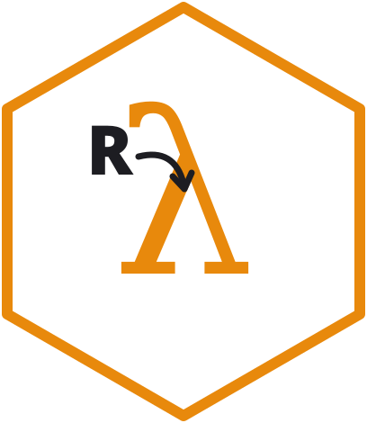

# r2lambda 

<!-- badges: start -->

[](https://github.com/discindo/r2lambda/actions/workflows/R-CMD-check.yml)
[](https://app.codecov.io/gh/discindo/r2lambda)
<!-- badges: end -->

The goal of `{r2lambda}` is to make it easier to go from an `R` script
to a deployed `AWS Lambda` function.

## Requirements

- [docker](https://docs.docker.com/get-docker/) is required to build,
  tag, and push the image.
- An AWS account. `build_lambda()` already creates the ECR repository
  for the image, and `deploy_lambda()` creates an IAM role and the
  Lambda function.

## Installation

You can install the development version of `{r2lambda}` like so:

``` r
# install.packages("remotes")
remotes::install_github("discindo/r2lambda")
```

## Setup

`r2lambda` assumes credentials for connecting to AWS services are
available in the `R` session. This can be done via an `.Renviron` file
that should set environmental variables like so:

    AWS_ACCESS_KEY_ID = "YOUR AWS ACCESS KEY ID"
    AWS_SECRET_ACCESS_KEY = "YOUR AWS SECRET ACCESS KEY"
    AWS_PROFILE = "YOUR AWS PROFILE"
    AWS_REGION = "YOUR AWS REGION"

But since `r2lambda` uses `paws` under the hood, all authentication
methods supported by `paws` are available in `r2lambda`. See
[here](https://github.com/paws-r/paws/blob/main/docs/credentials.md) for
details on setting credentials, region, profile, etc.

## Workflow

### Build a docker image for the lambda function

``` r
runtime_function <- "parity"
runtime_path <- system.file("parity.R", package = "r2lambda")
renvlock_path <- system.file("renv.lock", package = "r2lambda")
dependencies <- NULL

# Might take a while, its building a docker image
build_lambda(
  tag = "parity1",
  runtime_function = runtime_function,
  runtime_path = runtime_path,
  renvlock_path = renvlock_path,
  dependencies = dependencies
)
```

`build_lambda()` has a few more options:

- `support_path`: files or folders the runtime script needs. Each is
  copied next to the runtime script under its own name, so
  `support_path = "R"` lets the script call `source("R/helpers.R")`.
- `system_deps`: Amazon Linux 2023 packages to install with `dnf`, for R
  packages that need system libraries, e.g. `system_deps = "udunits2"`
  for `units`. Amazon Linux 2023 has no EPEL, so some libraries, such as
  GDAL, are not available.
- `architecture`: `"x86_64"` (default) or `"arm64"`. `deploy_lambda()`
  creates the function with the image’s architecture. Building for an
  architecture other than your machine’s needs Docker’s QEMU emulation.

### Test the lambda docker image locally

``` r
payload <- list(number = 2)
tag <- "parity1"
test_lambda(tag = "parity1", payload)
```

### Deploy to AWS Lambda

``` r
# Might take a while, its pushing it to a remote repository
deploy_lambda(tag = "parity1")
```

The function runs under a new IAM role with basic execution permissions.
To let it call other AWS services, attach policies to that role, or use
a role you already have:

``` r
deploy_lambda(
  tag = "parity1",
  policy_arns = "arn:aws:iam::aws:policy/AmazonS3ReadOnlyAccess"
)

deploy_lambda(tag = "parity1", role_arn = "arn:aws:iam::123456789012:role/my-role")
```

Inside the function, `paws` picks up the role’s temporary credentials,
so no AWS keys go into the image or the function’s settings.

### Invoke deployed lambda

``` r
invoke_lambda(
  function_name = "parity1",
  invocation_type = "RequestResponse",
  payload = list(number = 2),
  include_logs = FALSE
)

#> Lambda response payload:
#> {"parity":"even"}
```

## Code of Conduct

Please note that the r2lambda project is released with a [Contributor
Code of
Conduct](https://contributor-covenant.org/version/2/1/CODE_OF_CONDUCT.html).
By contributing to this project, you agree to abide by its terms.
