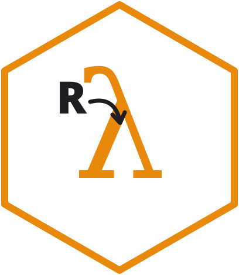

# r2lambda 

<!-- badges: start -->

[](https://github.com/discindo/r2lambda/actions/workflows/R-CMD-check.yml)
[](https://app.codecov.io/gh/discindo/r2lambda)
<!-- badges: end -->

The goal of `{r2lambda}` is to make it easier to go from an `R` script
to a deployed `AWS Lambda` function.

## System requirements

`{r2lambda}` calls two programs outside R. They are the same on Linux,
macOS and Windows; only how you install them differs.

- [Docker](https://docs.docker.com/get-docker/) with the
  [buildx](https://docs.docker.com/build/concepts/overview/#buildx)
  plugin, to build, run and push images. On macOS and Windows, install
  Docker Desktop, which includes buildx; on Windows, use its default
  Linux containers. On Linux, install Docker Engine and the buildx
  plugin, which some distributions package separately, e.g.
  `docker-buildx`. The `docker` command must be on the `PATH` and the
  Docker daemon must be running.
- [curl](https://curl.se/) 7.71 or later, used by `test_lambda()` to
  call the local container. macOS and current Windows 10 and 11 include
  it; on Linux, install it with your package manager. Check the version
  with `curl --version`.

## Installation

You can install the released version of `{r2lambda}` from CRAN with:

``` r
install.packages("r2lambda")
```

You can install the development version of `{r2lambda}` from GitHub with:

``` r
# install.packages("remotes")
remotes::install_github("discindo/r2lambda")
```

## Setup

You need an AWS account. `build_lambda()` creates the ECR repository
for the image, and `deploy_lambda()` creates an IAM role and the Lambda
function.

`r2lambda` assumes credentials for connecting to AWS services are
available in the `R` session. This can be done via an `.Renviron` file
that should set environmental variables like so:

    AWS_ACCESS_KEY_ID = "YOUR AWS ACCESS KEY ID"
    AWS_SECRET_ACCESS_KEY = "YOUR AWS SECRET ACCESS KEY"
    AWS_PROFILE = "YOUR AWS PROFILE"
    AWS_REGION = "YOUR AWS REGION"

But since `r2lambda` uses `paws` under the hood, all authentication
methods supported by `paws` are available in `r2lambda`. See
[here](https://github.com/paws-r/paws/blob/main/docs/credentials.md) for
details on setting credentials, region, profile, etc.

## Example

Build an image from `parity.R`, an example runtime script installed
with the package, test it locally, deploy it, invoke it, and delete it:

``` r
library(r2lambda)

build_lambda(
  tag = "parity1",
  runtime_function = "parity",
  runtime_path = system.file("parity.R", package = "r2lambda"),
  renvlock_path = system.file("renv.lock", package = "r2lambda")
)

test_lambda(tag = "parity1", payload = list(number = 2))

deploy_lambda(tag = "parity1", Timeout = 30)

invoke_lambda(
  function_name = "parity1",
  invocation_type = "RequestResponse",
  payload = list(number = 2)
)
#> Lambda response payload:
#> {"parity":"even"}

delete_lambda("parity1")
```

[Get started](https://discindo.github.io/r2lambda/articles/r2lambda.html)
explains each step and its options, including IAM policies, schedules
and multi-file projects. The
[articles](https://discindo.github.io/r2lambda/articles/) show complete
examples.

## Code of Conduct

Please note that the r2lambda project is released with a [Contributor
Code of
Conduct](https://contributor-covenant.org/version/2/1/CODE_OF_CONDUCT.html).
By contributing to this project, you agree to abide by its terms.
